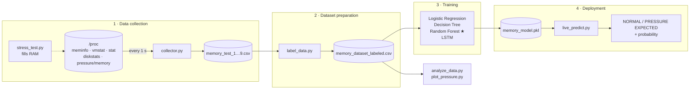

# AI Memory Pressure Prediction

**Predicting Linux memory pressure a few seconds before swapping, using machine learning on `/proc` metrics and Pressure Stall Information (PSI).**

Linux handles memory reactively: the kernel only reclaims pages and starts swapping once memory is already scarce, and by then applications are paying for it in latency. This project collects one-second snapshots of system metrics, labels the seconds that come just before memory pressure, and trains a classifier that warns **`PRESSURE EXPECTED`** before it happens, early enough to reclaim cache, migrate a workload or alert a scheduler.

This repository accompanies the paper *"Predicting Linux Memory Pressure Before Swapping with Machine Learning and Pressure Stall Information"* by Aditi, Ishani Majumder and Anshika Singh.

---

## Results at a glance

Four models were compared on a stratified 80/20 split (test set: 412 seconds, of which 7 are pressure onsets):

| Model | Accuracy | Precision | Recall | F1-score |
|---|---:|---:|---:|---:|
| Logistic Regression | 86.41% | 11.11% | 100.00% | 20.00% |
| Decision Tree | 99.03% | 80.00% | 57.14% | 66.67% |
| **Random Forest** | **99.03%** | **66.67%** | **85.71%** | **75.00%** |
| LSTM | 97.72% | 0.00% | 0.00% | 0.00% |

**Random Forest** gave the best balance: it caught 6 of the 7 pressure events with only 3 false alarms out of 405 normal seconds, so it is the deployed model. Accuracy alone is misleading here: the LSTM scores 97.7% while catching no events at all, because 98.2% of the data is "normal".

---

## How it works



1. **Collect.** `collector.py` reads kernel counters every second while `stress_test.py` (or any real workload) consumes memory.
2. **Label.** `label_data.py` merges the nine experiment runs and marks the 5 seconds before each pressure onset as `pressure_next_5s = 1`.
3. **Train.** Models are trained on 14 features with class-balanced weights. *(Training scripts are not in the repo yet; see [Training a model](#4-train-a-model).)*
4. **Predict live.** `live_predict.py` loads the trained Random Forest and classifies the machine's live metrics every second.

---

## Repository structure

```
ai-memory-pressure-prediction/
├── collector/
│   ├── collector.py        # samples /proc metrics every second → data/memory_data.csv
│   ├── stress_test.py      # gradually allocates ~3.4 GB to induce memory pressure
│   ├── label_data.py       # merges runs, adds the pressure_next_5s target
│   ├── analyze_data.py     # dataset summary: Normal vs Pressure averages and ranges
│   ├── plot_pressure.py    # plots available memory at the pressure-onset samples
│   └── live_predict.py     # real-time NORMAL / PRESSURE EXPECTED prediction
├── dashboard.py            # Streamlit dashboard (live RAM / swap metrics)
└── data/
    ├── memory_test_1.csv … memory_test_9.csv   # raw experiment runs
    ├── memory_test_3_pressure.csv              # run 3, with the stress workload
    ├── memory_data.csv                         # latest collector output
    └── memory_dataset_labeled.csv              # labelled dataset (2,058 rows)
```

---

## Requirements

- **Linux with PSI enabled**: kernel 4.20 or newer, with `/proc/pressure/memory` present. Developed and tested on Ubuntu.
- **Swap configured**: the recorded runs used a 2 GB swap area.
- **Python 3.8+**

```bash
pip install pandas scikit-learn joblib matplotlib streamlit psutil
```

`collector.py`, `stress_test.py`, `label_data.py` and `analyze_data.py` use only the Python standard library.

> **Run every script from the repository root.** The scripts use relative paths such as `data/memory_data.csv` and `memory_model.pkl`.

Check that PSI is available:

```bash
cat /proc/pressure/memory
# some avg10=0.00 avg60=0.00 avg300=0.00 total=0
# full avg10=0.00 avg60=0.00 avg300=0.00 total=0
```

---

## Usage

### 1. Collect data

Open two terminals. In the first, start the collector:

```bash
python collector/collector.py
```

In the second, run a workload. The included stress test allocates 10 MB every 0.4 s up to about 3.4 GB, holds it for 20 s, then releases it:

```bash
python collector/stress_test.py
```

Stop the collector with `Ctrl+C` when the run is finished. **`collector.py` overwrites `data/memory_data.csv` every time it starts**, so rename each run before the next one:

```bash
mv data/memory_data.csv data/memory_test_10.csv
```

> ⚠️ The stress test is meant to push the machine into memory pressure. Run it on a test machine or VM, and lower the `range(340)` loop count in `stress_test.py` if your system has less than ~4 GB of free RAM.

### 2. Label the dataset

```bash
python collector/label_data.py
```

This reads the runs listed in the `files` list at the top of the script (add any new runs there) and writes `data/memory_dataset_labeled.csv`:

```
Created: data/memory_dataset_labeled.csv
Total rows: 2058
Pressure onset prediction = 1: 37
Normal = 0: 2021
```

### 3. Explore the data

```bash
python collector/analyze_data.py    # per-feature averages and ranges, Normal vs Pressure
python collector/plot_pressure.py   # available memory at each pressure-onset sample
```

### 4. Train a model

The training scripts used in the paper are not committed yet. Until they are, this minimal script reproduces the paper's Random Forest setup (100 trees, balanced class weights, stratified 80/20 split with `random_state=42`) and saves `memory_model.pkl` for `live_predict.py`:

```python
import joblib
import pandas as pd
from sklearn.ensemble import RandomForestClassifier
from sklearn.metrics import classification_report
from sklearn.model_selection import train_test_split

FEATURES = [
    "memory_available_kb", "memory_free_kb", "memory_used_kb", "swap_used_kb",
    "page_faults_per_sec", "swap_in_per_sec", "swap_out_per_sec",
    "cpu_usage_percent", "disk_read_bytes_per_sec", "disk_write_bytes_per_sec",
    "psi_some_avg10", "psi_some_avg60", "psi_full_avg10", "psi_full_avg60",
]

df = pd.read_csv("data/memory_dataset_labeled.csv").dropna().drop_duplicates()
X, y = df[FEATURES], df["pressure_next_5s"]

X_train, X_test, y_train, y_test = train_test_split(
    X, y, test_size=0.2, stratify=y, random_state=42
)

model = RandomForestClassifier(n_estimators=100, class_weight="balanced")
model.fit(X_train, y_train)
print(classification_report(y_test, model.predict(X_test), digits=4))

joblib.dump(model, "memory_model.pkl")
```

Because the forest itself isn't seeded, the scores will vary slightly from run to run and from the paper's figures.

### 5. Run the live predictor

```bash
python collector/live_predict.py
```

Every second it prints the current readings and a verdict:

```
----------------------------------------------
Available Memory : 412.37 MB
Used Memory      : 3511.84 MB
Swap Used        : 0.00 MB
Page Faults      : 2650.00/sec
CPU Usage        : 27.45%

⚠️  PRESSURE EXPECTED
Pressure Probability: 71.00%
```

### 6. Open the dashboard

```bash
streamlit run dashboard.py
```

The dashboard currently shows live RAM usage, available RAM and swap usage. The PSI panel and the model prediction are placeholders that haven't been connected yet.

---

## Dataset

`data/memory_dataset_labeled.csv` holds **2,058 one-second observations** from nine runs recorded on 15 September 2026. Only **37 rows (1.8%)** are labelled as pressure onsets.

| Run | Rows | Pressure-onset rows |
|---|---:|---:|
| test_1 | 220 | 0 |
| test_2 | 232 | 0 |
| test_3_pressure | 150 | 5 |
| test_4 | 263 | 0 |
| test_5 | 137 | 5 |
| test_6 | 349 | 7 |
| test_7 | 254 | 10 |
| test_8 | 246 | 5 |
| test_9 | 207 | 5 |
| **Total** | **2,058** | **37** |

### Columns

| Group | Column | Source |
|---|---|---|
| Memory | `memory_available_kb`, `memory_free_kb`, `memory_used_kb` | `/proc/meminfo` (used = MemTotal − MemAvailable) |
| Swap | `swap_used_kb`, `swap_total_kb` | `/proc/meminfo` |
| Swap activity | `swap_in_per_sec`, `swap_out_per_sec` | `/proc/vmstat` (`pswpin`, `pswpout`) |
| Faults | `page_faults_per_sec` | `/proc/vmstat` (`pgfault`) |
| CPU | `cpu_usage_percent` | `/proc/stat` |
| Disk I/O | `disk_read_bytes_per_sec`, `disk_write_bytes_per_sec` | `/proc/diskstats` (`sd*`, `vd*`, `nvme*` devices) |
| PSI | `psi_some_avg10`, `psi_some_avg60`, `psi_full_avg10`, `psi_full_avg60` | `/proc/pressure/memory` |
| Metadata | `timestamp`, `experiment` | — |
| **Target** | `pressure_next_5s` | `label_data.py` |

The model uses **14 input features**: every metric above except `swap_total_kb`, which is constant, and the metadata columns.

### Labelling rule

For each run, `label_data.py`:

1. Marks a second as **under pressure** if `swap_out_per_sec > 0`, `psi_some_avg10 > 0` or `psi_full_avg10 > 0`.
2. Finds each **pressure onset**, the first second of a pressure stretch.
3. Labels the **5 seconds before each onset** as `pressure_next_5s = 1`. Everything else is `0`.
4. Drops the last 5 rows of each run, since there is no future window to label them against.

The model therefore learns to recognise the state of the system *just before* pressure appears, not pressure that has already started.

---

## Key findings

- **Memory level is the main early signal.** The three memory features carry just over half of the Random Forest's feature importance, with `memory_available_kb` alone at about 0.26. Page faults follow at about 0.09.
- **PSI adds a secondary signal, but on its own it arrives late.** The four PSI features together account for roughly a fifth of the importance. In the pressure run, PSI stayed at zero until available memory had almost run out, so a plain PSI threshold would fire too late.
- **Swap rates add almost nothing.** Swap activity is a *result* of pressure and only appears once swapping has started.
- **The LSTM didn't work with this little data.** Turning the runs into 10-step sequences left only 9 positive test sequences, which was too few for the network to learn from.

## Limitations

- Only 7 pressure seconds are in the test set, so the scores are uncertain (the 95% interval for recall is roughly 49–97%).
- The split is random, so neighbouring seconds from the same run can end up in both the training and test sets. A leave-one-run-out evaluation is needed to measure how well the model generalises.
- Pressure was produced with a synthetic stress workload. Real workloads such as databases, containers or builds may behave differently.
- The 5-second label window means the project doesn't yet measure how far ahead the warning really comes.

## Roadmap

- [ ] Commit the training, preprocessing and evaluation scripts, and the trained `memory_model.pkl`
- [ ] Connect the live prediction and PSI readings to the Streamlit dashboard
- [ ] Balance the classes with SMOTE / ADASYN and add more varied workloads (databases, containers, Kubernetes)
- [ ] Evaluate with leave-one-run-out cross-validation
- [ ] Benchmark XGBoost and Gradient Boosting, and revisit LSTM/GRU models on a larger dataset
- [ ] Measure the actual warning lead time before swapping starts
- [ ] Package the predictor as a lightweight daemon that works with cgroups

---

## Authors

**Aditi**, **Ishani Majumder** and **Anshika Singh**

If you use this work, please cite the accompanying paper:

> Aditi, I. Majumder and A. Singh, "Predicting Linux Memory Pressure Before Swapping with Machine Learning and Pressure Stall Information."
